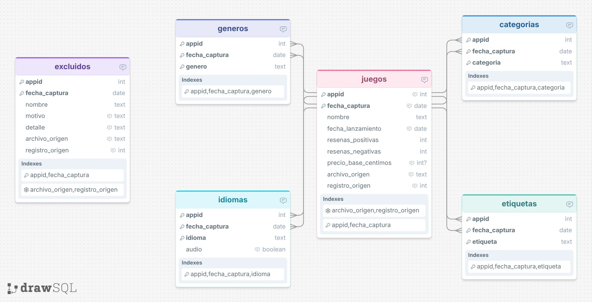

# Modelado y análisis con SQL

1. [Modelar (Tarea 4.1)](#1-modelar-tarea-41)

  

## 1. Modelar (Tarea 4.1)

Cómo se organizan las tablas preparadas en PostgreSQL y por qué.

Parte del diseño de la [Tarea 3.1](2_preparacion.md#1-entender-tarea-31) y de las tablas validadas en la [Tarea 3.4](2_preparacion.md#4-validar-y-guardar-tarea-34), en `data/processed/2026-11-18/`. Código: `sql/esquema.sql`, en el esquema `catalogo_steam`.

### Diagrama

### Conceptos del modelo

| Concepto | Para qué sirve | En nuestro modelo |
|---|---|---|
| **Entidad o tabla** | Agrupar información de un mismo tipo de elemento | `juegos`, sus cuatro tablas hijas (`generos`, `categorias`, `etiquetas`, `idiomas`) y `excluidos`. |
| **Unidad de observación** | Definir qué representa cada fila | Un juego en una captura, o un valor de un juego en una captura. |
| **Clave primaria** | Identificar cada fila con campos únicos y no nulos | `(appid, fecha_captura)` en `juegos` y `excluidos`. `(appid, fecha_captura, valor)` en las tablas hijas. |
| **Clave foránea** | Relacionar registros de distintas tablas | Cada tabla hija apunta a `juegos` por `(appid, fecha_captura)`. |
| **Tipo de dato** | Representar fechas, cantidades y textos con las operaciones adecuadas | `INTEGER`, `DATE`, `TEXT` y `BOOLEAN`, según el valor de la fuente. |
| **Restricción** | Exigir presencia, unicidad, relaciones y rangos válidos | `NOT NULL`, `PRIMARY KEY`, `FOREIGN KEY`, `UNIQUE` y `CHECK` sacados de las reglas de la preparación. |

### Tablas

| Tabla | Cada fila | Filas (captura 2026-11-18) | Clave primaria | Clave foránea |
|---|---|---|---|---|
| `juegos` | Un juego en una captura | 81.079 | `(appid, fecha_captura)` | — |
| `generos` | Un género oficial de un juego | 236.231 | `(appid, fecha_captura, genero)` | `(appid, fecha_captura)` → `juegos` |
| `categorias` | Una característica de un juego (Single-player, Co-op…) | 392.094 | `(appid, fecha_captura, categoria)` | `(appid, fecha_captura)` → `juegos` |
| `etiquetas` | Una etiqueta de la comunidad de un juego | 1.344.486 | `(appid, fecha_captura, etiqueta)` | `(appid, fecha_captura)` → `juegos` |
| `idiomas` | Un idioma de los textos de un juego, con si también está doblado a ese idioma | 333.369 | `(appid, fecha_captura, idioma)` | `(appid, fecha_captura)` → `juegos` |
| `excluidos` | Un juego apartado en la preparación, con su motivo | 203 | `(appid, fecha_captura)` | — |

Las columnas de cada tabla son las de su Parquet y en el mismo orden. Su significado está en el [diseño de la Tarea 3.1](2_preparacion.md#tabla-de-salida-juegos).

### Tipos de datos

| Tipo | Columnas | Motivo |
|---|---|---|
| `INTEGER` | `appid`, `resenas_positivas`, `resenas_negativas`, `precio_base_centimos`, `registro_origen` | Son números enteros. El mayor es el `appid` 5.160.840, muy lejos del límite de `INTEGER` (2.147 millones). El precio va en céntimos para no usar decimales. |
| `DATE` | `fecha_captura`, `fecha_lanzamiento` | Permite agrupar por año y mes y restar fechas (antigüedad del juego en la captura). La fuente no trae hora. |
| `TEXT` | `nombre`, `genero`, `categoria`, `etiqueta`, `idioma`, `motivo`, `detalle`, `archivo_origen` | Textos de longitud variable sin un máximo fijo en la fuente. |
| `BOOLEAN` | `audio` | Solo tiene dos valores: el juego también está doblado a ese idioma o no. |

### Campos obligatorios

| Campo | Obligatorio | Motivo |
|---|---|---|
| Todos salvo `precio_base_centimos` | Sí (`NOT NULL`) | La validación de la [Tarea 3.4](2_preparacion.md#controles) confirma 0 nulos. |
| `precio_base_centimos` | No | 69 juegos no se pueden comprar sueltos (retirados o solo en ediciones). El nulo representa que no hay un precio real. Los 12.795 juegos gratis tienen 0, no nulo. |

### Restricciones

| Restricción | Tablas | Regla | Motivo según la fuente |
|---|---|---|---|
| Juego por captura | `juegos`, `excluidos` | `PRIMARY KEY (appid, fecha_captura)` | `appid` no se repite en la captura. `fecha_captura` permite guardar otra captura sin cambiar el modelo. |
| Valor por juego | Tablas hijas | `PRIMARY KEY (appid, fecha_captura, valor)` | Un juego no repite género, categoría, etiqueta ni idioma. |
| Juego existente | Tablas hijas | `FOREIGN KEY (appid, fecha_captura)` → `juegos` | No puede haber valores de un juego que no está en `juegos`. |
| Línea única | `juegos`, `excluidos` | `UNIQUE (archivo_origen, registro_origen)` | Cada línea del RAW da un solo registro. |
| Identificador válido | `juegos`, `excluidos` | `appid > 0` | Steam numera los juegos desde 1. |
| Periodo | `juegos` | `fecha_lanzamiento` entre el 01/01/2020 y el 31/12/2025 | Es el periodo del proyecto. |
| Ya lanzado | `juegos` | `fecha_lanzamiento <= fecha_captura` | La preparación solo deja juegos lanzados. |
| Cantidades | `juegos` | Reseñas ≥ 0 y precio nulo o ≥ 0 | No existen reseñas ni precios negativos. |
| Motivo conocido | `excluidos` | `motivo` en `fuera_periodo`, `no_es_juego` o `precio_anomalo` | Son los tres motivos de las reglas de la [Tarea 3.3](2_preparacion.md#reglas). |
| Textos limpios | Todas | Sin vacíos ni espacios al principio o al final | La preparación limpia nombres y valores. Así un mismo valor no cuenta como dos. |
| Archivo de la captura | `juegos`, `excluidos` | `archivo_origen` empieza por `data/raw/<fecha_captura>/` | La ruta y la fecha de captura no se pueden contradecir. |

### Procedencia

Cada registro se puede localizar en su línea del archivo original.

| Columna | Tablas | Qué guarda | Ejemplo (Dictators:No Peace Countryballs, 1139890) |
|---|---|---|---|
| `fecha_captura` | Todas | Fecha de la carpeta de la captura | `2026-11-18` |
| `archivo_origen` | `juegos`, `excluidos` | Ruta del archivo RAW | `data/raw/2026-11-18/juegos_fichas.jsonl` |
| `registro_origen` | `juegos`, `excluidos` | Línea del juego en ese archivo, contada desde 0 | `3925` (línea 3926 en un editor) |

Las tablas hijas llegan a su línea a través de `(appid, fecha_captura)` en `juegos`.

### Decisiones

| Decisión | Alternativa descartada | Motivo |
|---|---|---|
| Varias tablas | Una sola tabla | Géneros, categorías, etiquetas e idiomas tienen varios valores por juego. En una tabla habría que guardar listas, que no se pueden agrupar ni llevar clave. |
| Tabla `excluidos` | No cargar los apartados | Conserva el motivo y la procedencia de los 203 juegos apartados. `juegos` + `excluidos` suman las 81.282 líneas del RAW. |
| `fecha_captura` en la clave | Clave solo con `appid` | Una nueva captura se suma sin borrar la anterior y sin cambiar el modelo. Las consultas de este proyecto filtran por la captura `2026-11-18`. |
| Procedencia en cada fila | Tabla aparte de archivos con un identificador | Cada captura sale de un solo archivo, así que esa tabla solo tendría una fila por captura. |
| Valores como texto | Tablas de catálogo con identificador (`genero_id`…) | El texto ya identifica el valor: 30 géneros, 63 categorías, 429 etiquetas y 103 idiomas, sin variantes. Un identificador solo añadiría un JOIN a cada consulta. |
| Índices por `fecha_captura` y valor | Solo las claves primarias | Las consultas agrupan por género, categoría, etiqueta, idioma o fecha dentro de una captura. |
